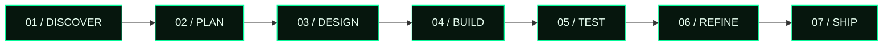

<!-- 01 / HERO -->

 

&nbsp;

&nbsp;

  

---

<!-- 02 / ABOUT -->

## `02.0` — ABOUT / IDENTITY

<table>
<tr>
<td width="62%" valign="middle">

### Sifat Hossen Shuvo
**Developer. Designer. Builder of digital experiences.**

I'm a developer from Bangladesh who enjoys turning ideas into polished, useful web experiences. My work sits at the intersection of frontend engineering, full-stack development, interface design, animation, and AI-powered experiments.

I care about the details people feel: a layout that makes sense, motion that has a purpose, code that can be maintained, and a product that works beyond the screenshot.

> **My rule:** make it useful, make it clear, then make it memorable.

</td>
<td width="38%" valign="middle">

</td>
</tr>
</table>

---

<!-- 03 / SKILLS -->

## `03.0` — SKILL MATRIX

**01 / FRONTEND ENGINEERING**

**02 / BACKEND & DATA**

**03 / CREATIVE TECHNOLOGY**

**04 / TOOLS & DELIVERY**

<table>
<tr>
<td width="50%" valign="top">

**WEB DEVELOPMENT**
- HTML5 · CSS3 · JavaScript ES6+
- React.js · React Router
- Tailwind CSS · Bootstrap
- Node.js · Express.js · MongoDB
- REST APIs · Fetch · Axios · CRUD

</td>
<td width="50%" valign="top">

**DESIGN & INTEGRATION**
- UI/UX · Figma
- Framer Motion · Web animation
- Three.js exploration
- Firebase · JWT concepts
- AI API integration · Prompt engineering

</td>
</tr>
</table>

Skill list reflects technologies and areas I work with or explore; it is not a claim of expert-level proficiency in every tool.

---

<!-- 04 / SERVICES -->

## `04.0` — SERVICES / WHAT I CAN BUILD

<table>
<tr>
<td width="50%" valign="top">

### `01` — Web Interfaces
Responsive landing pages, personal websites, portfolio experiences, and clean multi-section interfaces.

</td>
<td width="50%" valign="top">

### `02` — React Applications
Reusable components, routing, state-driven UI, search experiences, dashboards, and interactive web apps.

</td>
</tr>
<tr>
<td width="50%" valign="top">

### `03` — API Integration
Connect frontend interfaces to REST APIs, handle loading and error states, and present data clearly.

</td>
<td width="50%" valign="top">

### `04` — UI Motion & Polish
Micro-interactions, transitions, animated sections, responsive refinements, and visual consistency.

</td>
</tr>
<tr>
<td width="50%" valign="top">

### `05` — Full-Stack Foundations
CRUD workflows and web application features using Node.js, Express, and MongoDB.

</td>
<td width="50%" valign="top">

### `06` — AI-Powered Experiments
Frontend experiences connected to AI APIs, developer assistants, and practical AI features.

</td>
</tr>
</table>

For a project inquiry, share the goal, required features, deadline, and any reference design so scope can be discussed clearly.

---

<!-- 05 / PROJECTS -->

## `05.0` — PROJECT ARCHIVE / SELECTED BUILDS

<table>
<tr>
<td width="50%" valign="top">

### `BUILD 001` / AI CODING ASSISTANT

A hacker-console-inspired AI coding assistant concept focused on a developer-first interface and AI conversations.

`React` `Tailwind CSS` `OpenRouter`

<a href="https://github.com/Sifathossensuvo?tab=repositories">↗ Find repository</a>

</td>
<td width="50%" valign="top">

### `BUILD 002` / PERSONAL HOMEPAGE

A custom Chrome-style homepage built to create a personalized starting point for browsing.

`HTML` `CSS` `JavaScript`

<a href="https://shhomepage.netlify.app/">↗ Open live project</a>

</td>
</tr>
<tr>
<td width="50%" valign="top">

### `BUILD 003` / MOVIE DISCOVERY

A responsive React movie explorer with title search and a detailed movie modal, using the TVMaze API.

`React` `JavaScript` `TVMaze API`

<a href="https://github.com/Sifathossensuvo?tab=repositories">↗ Find repository</a>

</td>
<td width="50%" valign="top">

### `BUILD 004` / MEDIA PLAYER

A media player concept with a hacker-inspired visual identity and custom interactive controls.

`HTML` `CSS` `JavaScript`

<a href="https://github.com/Sifathossensuvo?tab=repositories">↗ Find repository</a>

</td>
</tr>
</table>

Some project links currently open the repository list because their direct repository URLs were not provided. Replace those links with the exact project URLs before publishing.

---

<!-- 06 / WORKFLOW -->

## `06.0` — ENGINEERING WORKFLOW

<table>
<tr>
<td width="33%" valign="top">

**DISCOVER**

Understand the goal, audience, content, and essential user journey before choosing the implementation.

</td>
<td width="33%" valign="top">

**ENGINEER**

Build reusable components, responsive layouts, API states, and understandable project structure.

</td>
<td width="33%" valign="top">

**REFINE**

Check mobile and desktop behavior, verify interactions, fix edge cases, and polish visual details.

</td>
</tr>
</table>

---

<!-- 07 / JOURNEY -->

## `07.0` — DEVELOPER JOURNEY

| STAGE | FOCUS | OBJECTIVE |
|:---:|---|---|
| `01` | Learn | Strengthen programming fundamentals |
| `02` | Build | Turn concepts into working projects |
| `03` | Explore | Experiment with tools, APIs, and motion |
| `04` | Improve | Practice debugging and code quality |
| `05` | Share | Document work and learn from feedback |

> Progress is not a straight line. The aim is to keep learning, keep shipping, and make the next version better.

---

<!-- 08 / TESTIMONIALS -->

## `08.0` — COLLABORATION / FEEDBACK

I value clear communication, honest feedback, and practical collaboration. The best projects come from understanding the problem together and iterating with purpose.

<table>
<tr>
<td width="50%" valign="top">

### WHAT YOU CAN EXPECT

- Clear discussion of project goals
- Thoughtful UI and responsive behavior
- Progress updates and feedback loops
- A focus on usability and maintainability

</td>
<td width="50%" valign="top">

### CLIENT / TEAM REVIEWS

I am keeping this area reserved for **real feedback from clients, teammates, or collaborators**. I won't publish made-up testimonials or attribute quotes to people who haven't said them.

**Want to collaborate?** Get in touch below.

</td>
</tr>
</table>

---

<!-- 09 / CURRENT FOCUS -->

## `09.0` — CURRENT FOCUS / ACTIVE R&D

<table>
<tr>
<td width="50%" valign="top">

### BUILDING

- CODE NINJA AI — AI coding assistant interface
- SH Homepage — personalized browser homepage
- CODE NINJA Media Player — custom media experience
- Portfolio presentation and project documentation

</td>
<td width="50%" valign="top">

### EXPLORING

- JavaScript fundamentals and problem-solving
- React architecture and reusable UI
- Better responsive and motion design
- Full-stack workflows and API integration
- Practical AI-powered application ideas

</td>
</tr>
</table>

---

<!-- 10 / GITHUB STATS -->

## `10.0` — GITHUB TELEMETRY

  

  

These images are generated by third-party services. Availability, cache delays, and rate limits may affect whether they display. Stats reflect the public data those services can access.

---

<!-- 11 / PRINCIPLES -->

## `11.0` — DESIGN & CODE PRINCIPLES

<table>
<tr>
<td width="50%" valign="top">

### DESIGN DIRECTIVES

`01` — Visual hierarchy before decoration  
`02` — Motion should have a purpose  
`03` — Responsive from the beginning  
`04` — Contrast and readability matter  
`05` — Details should support the content

</td>
<td width="50%" valign="top">

### ENGINEERING DIRECTIVES

`01` — Prefer clarity over cleverness  
`02` — Reuse patterns where they help  
`03` — Handle loading and error states  
`04` — Verify interactions before shipping  
`05` — Learn from bugs instead of hiding them

</td>
</tr>
</table>

---

<!-- 12 / ROADMAP -->

## `12.0` — NEXT ITERATION / ROADMAP

| TRACK | DIRECTION |
|---|---|
| `FOUNDATIONS` | Practice JavaScript, outputs, and problem-solving |
| `FRONTEND` | Build confident, accessible React experiences |
| `FULL STACK` | Expand complete apps with backend workflows |
| `CREATIVE` | Explore animation, Three.js, and interactive design |
| `AI LAB` | Build useful AI-assisted developer experiences |
| `OPEN SOURCE` | Document projects and contribute where possible |

---

<!-- 13 / CONTACT -->

## `13.0` — OPEN A CONNECTION

<table>
<tr>
<td width="60%" valign="middle">

### Have an idea worth building?

I'm interested in thoughtful web experiences, creative technology, useful developer tools, and learning through collaboration.

**Send a project idea, share feedback, or explore what I'm building.**

</td>
<td width="40%" valign="middle">

</td>
</tr>
</table>

**SIFAT HOSSEN SHUVO**  
`DESIGN WITH INTENT` &nbsp; / &nbsp; `ENGINEER WITH PURPOSE` &nbsp; / &nbsp; `KEEP EVOLVING`

Built with curiosity, code, and a commitment to continuous improvement.

