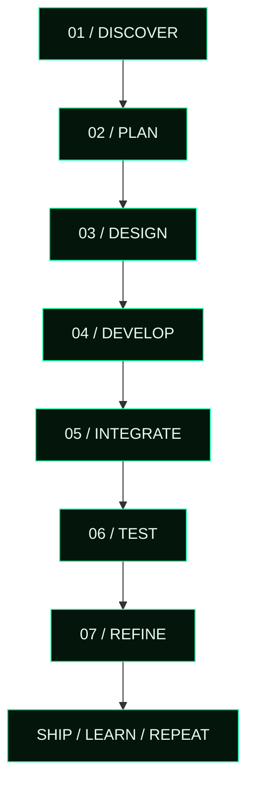

<!--
╔══════════════════════════════════════════════════════════════════════╗
║  SHUVO // DIGITAL UNIVERSE                                           ║
║  Profile README · Cyberpunk · Creative Engineering · Anime Atmosphere║
╚══════════════════════════════════════════════════════════════════════╝

SETUP
1. Create a PUBLIC repository named exactly: Sifathossensuvo
2. Add this file as README.md in the repository root.
3. Replace placeholder LinkedIn/email/resume links with your real links.
4. Replace generic repository links in project cards with each project's URL.
5. Optional: remove any animated image URL if an external service is unavailable.

NOTE
GitHub sanitizes README HTML and does not support arbitrary CSS/JavaScript.
This design uses Markdown, supported HTML, SVG/image endpoints and links.
-->

<div align="center">


<br/>

<a href="https://github.com/Sifathossensuvo?tab=repositories">
  
</a>
&nbsp;
<a href="https://shhomepage.netlify.app/">
  
</a>
&nbsp;
<a href="https://github.com/Sifathossensuvo">
  
</a>

<br/><br/>


</div>

---

<div align="center">

`IDENTITY` &nbsp; ◈ &nbsp; `ENGINEERING` &nbsp; ◈ &nbsp; `PROJECTS` &nbsp; ◈ &nbsp; `LAB` &nbsp; ◈ &nbsp; `ANALYTICS` &nbsp; ◈ &nbsp; `CONNECT`

</div>

<a id="01-identity"></a>

## `01 // IDENTITY PROTOCOL`

<table>
<tr>
<td width="59%" valign="middle">


# Sifat Hossen Shuvo

### Full Stack Developer · Digital Creator

I build modern web applications, interactive interfaces, and digital products that turn ideas into useful experiences.

I enjoy working across frontend engineering, backend development, interface design, creative coding, web animation, and AI-powered applications. My goal is to combine thoughtful design with practical functionality—and keep improving with every project.

<a href="https://github.com/Sifathossensuvo?tab=repositories"></a>
<a href="https://shhomepage.netlify.app/"></a>

</td>
<td width="41%" align="center" valign="middle">


<br/>


<br/>

<br/>


</td>
</tr>
</table>

> **DESIGN WITH INTENT. ENGINEER WITH PURPOSE. KEEP EVOLVING.**

---

<a id="02-terminal"></a>

## `02 // LIVE TERMINAL`

<div align="center">


</div>

```text
┌───────────────────────────────────────────────────────────────┐
│ SHUVO OS  /  DEVELOPER CONSOLE                     [ ONLINE ] │
├───────────────────────────────────────────────────────────────┤
│                                                               │
│  $ whoami                                                     │
│  > Sifat Hossen Shuvo                                         │
│                                                               │
│  $ mission --current                                          │
│  > Build thoughtful, useful digital experiences               │
│                                                               │
│  $ interests --list                                           │
│  > Frontend Engineering                                       │
│  > Full Stack Development                                     │
│  > UI/UX & Motion Design                                      │
│  > Creative Coding & AI Integration                           │
│                                                               │
│  $ philosophy                                                  │
│  > Better Code. Bigger Dreams.                                 │
│                                                               │
│  $ next                                                        │
│  > Keep learning. Keep building.                               │
│                                                               │
└───────────────────────────────────────────────────────────────┘
```

<div align="center">


</div>

---

<a id="03-principles"></a>

## `03 // CORE DIRECTIVES`

<table>
<tr>
<td width="33%" valign="top">

### `01 / CLARITY`

Write understandable code. Build interfaces that communicate clearly. Keep the user experience at the center.

</td>
<td width="33%" valign="top">

### `02 / CRAFT`

Care about layout, details, motion, accessibility, responsiveness, and the small choices that make products feel considered.

</td>
<td width="33%" valign="top">

### `03 / EVOLUTION`

Learn by building, test ideas in practice, accept feedback, and improve the next iteration.

</td>
</tr>
</table>

---

<a id="04-engineering"></a>

## `04 // ENGINEERING ARSENAL`

<div align="center">


**FRONTEND ENGINEERING**


**BACKEND & DATA**


**CREATIVE TECHNOLOGY**


**WORKFLOW & DELIVERY**

</div>

<table>
<tr>
<td width="50%" valign="top">

### FRONTEND SYSTEMS

- HTML5 and CSS3
- JavaScript ES6+
- React.js and React Router
- Tailwind CSS and Bootstrap
- Responsive UI development
- Framer Motion and web animation
- API integration with Fetch and Axios

</td>
<td width="50%" valign="top">

### BACKEND SYSTEMS

- Node.js and Express.js
- MongoDB
- REST API development and integration
- CRUD workflows
- Authentication concepts, JWT and Firebase
- Server-side application fundamentals

</td>
</tr>
<tr>
<td width="50%" valign="top">

### CREATIVE ENGINEERING

- UI/UX design and Figma
- Three.js exploration
- Interactive interfaces
- Motion design
- AI API integration
- Prompt engineering

</td>
<td width="50%" valign="top">

### DEVELOPER WORKFLOW

- Git and GitHub
- VS Code
- Postman
- npm and Vite
- Vercel
- Debugging and browser tools
- Project documentation

</td>
</tr>
</table>

---

<a id="05-architecture"></a>

## `05 // HOW I BUILD`

<div align="center">



</div>

<table>
<tr>
<td width="50%" valign="top">

**BUILD PRINCIPLES**

- Component-based structure
- Reusable UI patterns
- Responsive layouts
- Readable implementation
- Maintainable code
- Useful documentation

</td>
<td width="50%" valign="top">

**QUALITY CHECKS**

- Verify the core user flow
- Check mobile and desktop layouts
- Handle loading and error states
- Test API responses
- Review links and navigation
- Refine details after testing

</td>
</tr>
</table>

---

<a id="06-projects"></a>

## `06 // PROJECT MULTIVERSE`

<div align="center">


</div>

<table>
<tr>
<td width="50%" valign="top">


### `01 / AI DEVELOPMENT`

An AI coding assistant concept with a hacker-console identity, developer-focused conversations, and a custom interface.

**STACK:** `React` `Tailwind CSS` `OpenRouter`

<a href="https://github.com/Sifathossensuvo?tab=repositories"></a>

</td>
<td width="50%" valign="top">


### `02 / PERSONAL BROWSER EXPERIENCE`

A custom Chrome-style homepage designed as a personalized starting point for browsing.

**STACK:** `HTML` `CSS` `JavaScript`

<a href="https://shhomepage.netlify.app/"></a>

</td>
</tr>
<tr>
<td width="50%" valign="top">


### `03 / MOVIE DISCOVERY`

A responsive React application for searching movie titles and exploring detailed movie information.

**STACK:** `React` `JavaScript` `TVMaze API`

<a href="https://github.com/Sifathossensuvo?tab=repositories"></a>

</td>
<td width="50%" valign="top">


### `04 / MEDIA EXPERIENCE`

A custom media player concept with a hacker-inspired interface and a focus on interactive controls.

**STACK:** `HTML` `CSS` `JavaScript`

<a href="https://github.com/Sifathossensuvo?tab=repositories"></a>

</td>
</tr>
</table>

<div align="center">

<a href="https://github.com/Sifathossensuvo?tab=repositories">

</a>

</div>

> **Project links:** The generic repository buttons above open the GitHub repository list. Replace them with each project's direct repository URL when available.

---

<a id="07-current-work"></a>

## `07 // CURRENT WORKSPACE`

<table>
<tr>
<td width="50%" valign="top">

### BUILDING

- CODE NINJA AI — AI coding assistant experience
- SH Homepage — custom browser homepage
- CODE NINJA Media Player — media UI experience
- Personal portfolio and project presentation

</td>
<td width="50%" valign="top">

### PRACTICING

- JavaScript fundamentals and problem-solving
- React patterns and application structure
- Responsive UI and motion design
- Full-stack development workflows
- AI integrations and creative experiments

</td>
</tr>
</table>

---

<a id="08-creative-lab"></a>

## `08 // CREATIVE LAB`

<div align="center">


</div>

<table>
<tr>
<td width="33%" valign="top">

### MOTION LAB

Exploring interface transitions, animation timing, micro-interactions, and motion that supports usability.

</td>
<td width="33%" valign="top">

### VISUAL LAB

Experimenting with typography, contrast, dark interfaces, visual hierarchy, and consistent design systems.

</td>
<td width="33%" valign="top">

### AI LAB

Exploring practical AI integrations, developer-focused tools, prompt engineering, and useful automation ideas.

</td>
</tr>
</table>

---

<a id="09-journey"></a>

## `09 // DEVELOPER JOURNEY`

<div align="center">

| PHASE | DIRECTIVE | PURPOSE |
|:---:|---|---|
| `01` | LEARN | Strengthen fundamentals and problem-solving |
| `02` | BUILD | Turn ideas into practical applications |
| `03` | EXPLORE | Experiment with new tools and techniques |
| `04` | REFINE | Improve code quality and user experience |
| `05` | EVOLVE | Keep learning through real projects |

</div>

---

<a id="10-github"></a>

## `10 // GITHUB OPERATIONS CENTER`

<div align="center">


<br/><br/>


<br/><br/>

<a href="https://github.com/Sifathossensuvo?tab=repositories"></a>
<a href="https://github.com/Sifathossensuvo?tab=activity"></a>
<a href="https://github.com/Sifathossensuvo/followers"></a>

</div>

### CONTRIBUTION MAP

<div align="center">


</div>

---

<a id="11-achievements"></a>

## `11 // MILESTONES & ACHIEVEMENTS`

<table>
<tr>
<td width="33%" valign="top">

### `MILESTONE 01`

**FOUNDATIONS**

Learning web technologies and strengthening the fundamentals behind modern applications.

</td>
<td width="33%" valign="top">

### `MILESTONE 02`

**PROJECT BUILDING**

Applying knowledge through portfolio projects, API integrations, and responsive interfaces.

</td>
<td width="33%" valign="top">

### `MILESTONE 03`

**CONTINUOUS GROWTH**

Improving technical skills, exploring new ideas, and building more complete experiences.

</td>
</tr>
</table>

---

<a id="12-roadmap"></a>

## `12 // NEXT ITERATION ROADMAP`

<div align="center">

| TRACK | NEXT OBJECTIVE |
|---|---|
| `ENGINEERING` | Deepen JavaScript and React fundamentals |
| `FULL STACK` | Build more complete end-to-end applications |
| `DESIGN` | Refine responsive layouts and motion systems |
| `AI` | Explore useful AI-powered application ideas |
| `QUALITY` | Improve testing, debugging, and maintainability |
| `PORTFOLIO` | Document projects and showcase real outcomes |

</div>

---

<a id="13-principles"></a>

## `13 // DEVELOPER MANIFESTO`

<div align="center">


</div>

```text
01 / STAY CURIOUS
02 / BUILD BEFORE YOU ASSUME
03 / DEBUG WITH PATIENCE
04 / DESIGN FOR PEOPLE
05 / LEARN FROM EVERY ITERATION
06 / KEEP MOVING FORWARD
```

---

<a id="14-connect"></a>

## `14 // ESTABLISH CONNECTION`

<table>
<tr>
<td width="60%" valign="middle">

### Let's build something meaningful.

Interested in web development, creative technology, AI-powered tools, or useful digital products? Explore my projects and connect with me.

<a href="https://github.com/Sifathossensuvo"></a>
<a href="https://shhomepage.netlify.app/"></a>
<a href="https://www.linkedin.com/"></a>

</td>
<td width="40%" align="center" valign="middle">


</td>
</tr>
</table>

---

<div align="center">


**SIFAT HOSSEN SHUVO**  
`DESIGN WITH INTENT` &nbsp; / &nbsp; `ENGINEER WITH PURPOSE` &nbsp; / &nbsp; `KEEP EVOLVING`

<sub>Built with curiosity, code, and a commitment to continuous improvement.</sub>

</div>
